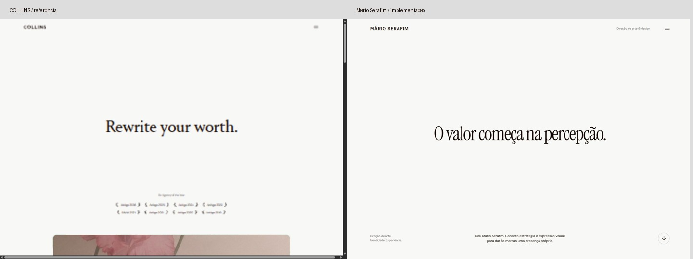
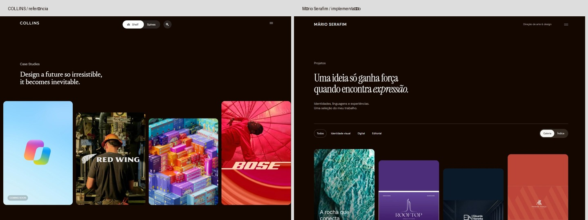
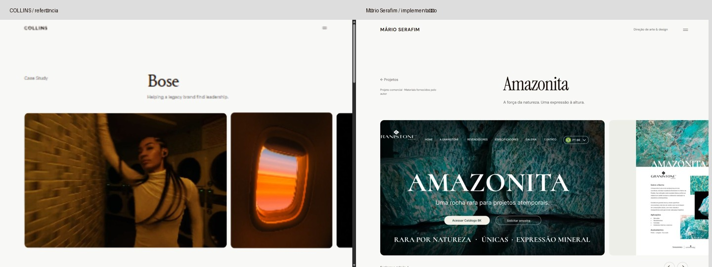
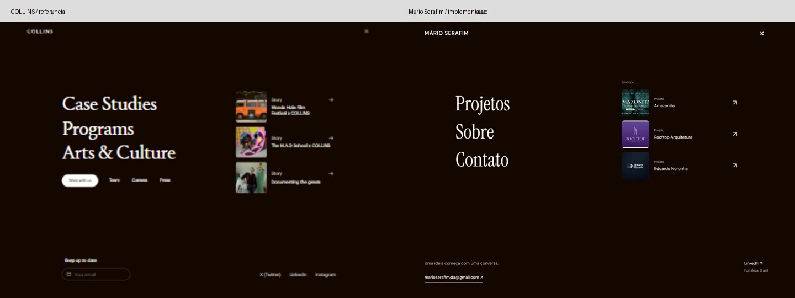

# Novo portfólio Mário Serafim — entrega para revisão

18 de outubro de 2026. Prévia: http://127.0.0.1:3001/. O site foi construído e validado localmente; não foi publicado.

## 1. Arquitetura

Next.js 16.4.2, React 19.3.1, TypeScript e CSS próprio. App Router com oito páginas de conteúdo pré-renderizadas, componentes reutilizáveis e dados dos projetos separados da apresentação. Sem biblioteca de animação, CMS, CRM ou dependência de serviços externos para renderizar as páginas. Fontes e mídias são locais. Metadados, imagem Open Graph, sitemap, robots e página 404 estão implementados.

Componentes principais: navegação em dialog, rodapé, controle de tema, serviços expansíveis, galeria com filtros e índice, faixa horizontal de imagens, narrativa expandida, vídeo e formulário progressivo. A branch é `rebuild/collins-editorial`. O diretório estava vazio no início; nenhum design anterior foi reaproveitado.

## 2. Adaptação da referência COLLINS

A [auditoria prévia](../COLLINS_REFERENCE_AUDIT.md) documenta navegação real nas cinco páginas pedidas, estilos observados e capturas a 1440, 768 e 390 px.

Foram adaptados: abertura com amplo espaço vazio e título central, contraste entre serifas editoriais e interface sans, menu de tela inteira com duas colunas e projetos em foco, margens amplas, labels pequenos, listas de serviços com regras finas, galeria escura com quatro colunas deslocadas e duas no celular, cabeçalho de case assimétrico, galeria horizontal com cantos arredondados, história em sobreposição e rodapé de links grandes.

As transições usam opacidade e deslocamento curto; imagens têm escala sutil, setas e controles têm estados de foco, e seções entram conforme o scroll. `prefers-reduced-motion` remove animações e impede autoplay automático do vídeo. O vídeo tem controles e pausa. O tema inicia pela preferência do sistema e mantém a escolha local do visitante.

A adaptação não reproduz a identidade da COLLINS, seus textos, código, fontes comerciais ou imagens. Serviços, textos, provas profissionais e cases pertencem ao contexto individual de Mário. O modo índice e os filtros são uma adaptação à seleção real de quatro cases; não foi criada uma biblioteca fictícia de projetos ou artigos. Durações e curvas exatas da referência não são alegadas como verificadas.

## 3. Fontes e cores

- Títulos: Instrument Serif regular e italic, licença OFL.
- Interface e textos: DM Sans regular, medium e semibold, licença OFL.
- Papel `#F8F8F7`, tinta `#140700`, branco `#FFFFFF`, cinza `#D0D0C8`, superfície `#EEEEE9`, texto secundário `#625D59`.
- Tema escuro: fundo `#140700`, texto `#F8F8F7`, superfície `#271A12`, secundário `#BBB4AE`.

As cores dos projetos aparecem apenas nas respectivas mídias e paletas. Fontes referidas dentro de cada manual são parte do trabalho apresentado, não fontes carregadas pela interface do portfólio.

## 4. Fontes e conteúdo confirmado

A [verificação de conteúdo](CONTENT_VERIFICATION.md) registra links, evidências e limites. Dados profissionais foram extraídos de resultados públicos do LinkedIn; a leitura direta do perfil completo foi bloqueada. Foram confirmados nome, localização, vínculo com Granistone, foco criativo/digital, informações parciais de estudos e participação pública em palestra.

Os quatro cases usam a pasta do Google Drive indicada pelo usuário: Amazonita, Rooftop Arquitetura, Eduardo Noronha e Amanda Araújo. Manuais e peças foram examinados antes da redação. As aplicações simuladas estão identificadas, a arquitetura não é atribuída ao designer e a assinatura Amplify foi conservada nos créditos de Rooftop. Não foram inventados clientes, depoimentos, prêmios ou resultados numéricos.

## 5. Páginas concluídas

| Tipo | Endereço local |
| --- | --- |
| Início | `/` |
| Projetos, filtros e índice | `/projetos` |
| Amazonita | `/projetos/amazonita` |
| Rooftop Arquitetura | `/projetos/rooftop` |
| Eduardo Noronha | `/projetos/eduardo-noronha` |
| Amanda Araújo | `/projetos/amanda-araujo` |
| Sobre, sem fotografia pessoal | `/sobre` |
| Contato progressivo | `/contato` |

## 6. Testes e resultados

Build de produção e verificação TypeScript concluídos sem erros. Dois testes automatizados do contato passaram: preservação de acentos/quebras e destinatário no mailto, e geração de rascunho EML com UTF-8. A [verificação HTTP](validation/routes.json) aprovou **50/50** endereços, incluindo páginas, mídia, metadados e o 404 esperado de case inexistente.

Teste Lighthouse em Chrome headless, versão de produção local, perfil mobile padrão com simulação de rede/CPU, sem desativar animações para o teste:

| Página | Desempenho | Acessibilidade | SEO |
| --- | ---: | ---: | ---: |
| Início — celular | 93 | 100 | 100 |
| Projetos — celular | 95 | 100 | 100 |
| Amazonita — celular | 91 | 100 | 100 |
| Sobre — celular | 96 | 100 | 100 |
| Contato — celular | 94 | 100 | 100 |
| Início — desktop | 100 | 100 | 100 |

Relatórios completos em [validation](validation/). Os resultados são medições de laboratório local, não garantias de desempenho na hospedagem ou certificação integral de acessibilidade. A otimização da imagem inicial e do poster reduziu o carregamento do case, que havia medido 89, para 91. As demais páginas de case compartilham o mesmo template; não foram auditadas individualmente por Lighthouse.

Inspeção no navegador a 390, 768 e 1440 px para os cinco tipos de página; os três cases restantes também foram examinados a 390 px. Nenhum transbordamento horizontal do documento nas 18 combinações medidas ([medidas](validation/responsive.json)). A faixa de mídia do case tem scroll horizontal intencional dentro do seu próprio contêiner.

Interações verificadas: menu e navegação entre páginas; Escape e retorno de foco ao acionador; filtros Digital (1), Identidade visual (3), Editorial (2) e Todos (4); índice com quatro itens; avanço da faixa de imagens; abertura/fechamento da história; expansão dos serviços; tema persistente após recarregar; validação dos campos obrigatórios; três etapas do briefing; preservação do texto ao voltar; link com destinatário correto; cópia do briefing e download de `.eml`. Nenhuma mensagem foi enviada. Nenhum erro ou aviso registrado no console da versão de produção durante esses testes ([registro](validation/interactions.json)).

O tratamento de movimento reduzido foi revisado no código; não foi executada uma matriz de navegadores/tecnologias assistivas. Safari/iOS reais e leitores de tela continuam sendo uma verificação complementar recomendada antes de publicação.

## 7. Comparações visuais

COLLINS à esquerda; implementação à direita. Capturas reais, com corte do topo para comparar a composição; não representam igualdade de conteúdo ou tipografia proprietária.

As capturas completas das cinco páginas nas três larguras estão em [screenshots/portfolio](screenshots/portfolio/). Visões de conjunto: [celular](screenshots/review-390.jpg), [desktop](screenshots/review-1440.jpg) e [outros cases](screenshots/review-other-cases.jpg). Registros de referência permanecem somente na documentação, fora dos assets servidos pelo site.

## 8. Pendências reais

1. **Revisão de conteúdo antes de publicar:** preferência do e-mail, créditos individuais de terceiros e relação com Amplify no case Rooftop. O acervo foi autorizado para esta execução; a documentação não substitui a revisão final de exposição pública.
2. **Biografia completa:** cargos e datas exatos, curso de Belas Artes e eventuais experiências adicionais não puderam ser confirmados. O conteúdo atual usa apenas os dados disponíveis, sem completar lacunas por suposição.
3. **Domínio e hospedagem:** definir o domínio, preencher `NEXT_PUBLIC_SITE_URL` e refazer o build. Nenhuma implantação foi feita.
4. **Envio direto opcional:** hoje o formulário prepara um e-mail, oferece cópia e download de rascunho; o visitante envia no próprio aplicativo. Para envio direto pelo site, falta configurar serviço de e-mail, credenciais e proteção contra abuso. A interface explica esse fluxo com clareza.

Os materiais atuais, os oito endereços e o contato com fallback estão prontos para revisão local.
